# MouthLife on iPhone Duo: plan (for the owner's review)

Status on `master` at `071b3f6`: **nothing Duo-specific is built.** This is a plan to review before
any code is written. Scope: the iPhone Duo only (its 5.4" cover screen and its 7.6" folding inner
screen). Android and web foldables are out of scope for now. Widgets for every iPhone, iPad, Apple
HomeView and the Duo's two Home Screens are planned in [`widget-plan.md`](widget-plan.md).
Reviewed read-only by agy and Codex (2026-11-19); their corrections are folded in below.

## 1. What we checked (2026-11-19)

- Xcode 27.2 (27B52), the iPhone Duo simulator (iOS 27.2 runtime for iPhone19,4), today's app
  unchanged, in English, German and Japanese.
- Every Duo API name in the owner's notes against the Xcode 27.2 SDK headers (section 6).

### Today's app on the Duo, unchanged

| | Cover (folded) | Inner, open flat (book) | Inner, half-open 100° (Tabletop) |
|---|---|---|---|
| Prologue | 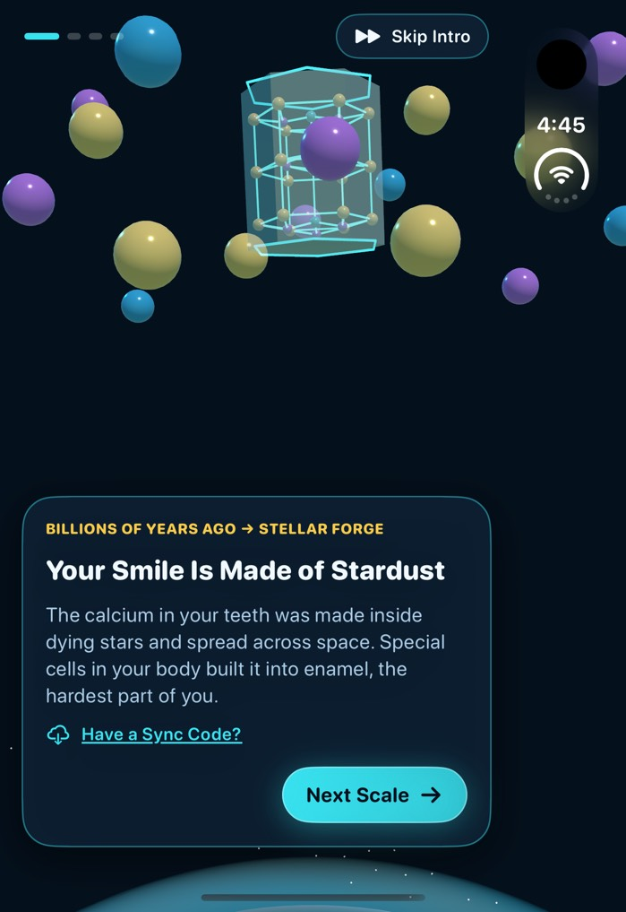 | 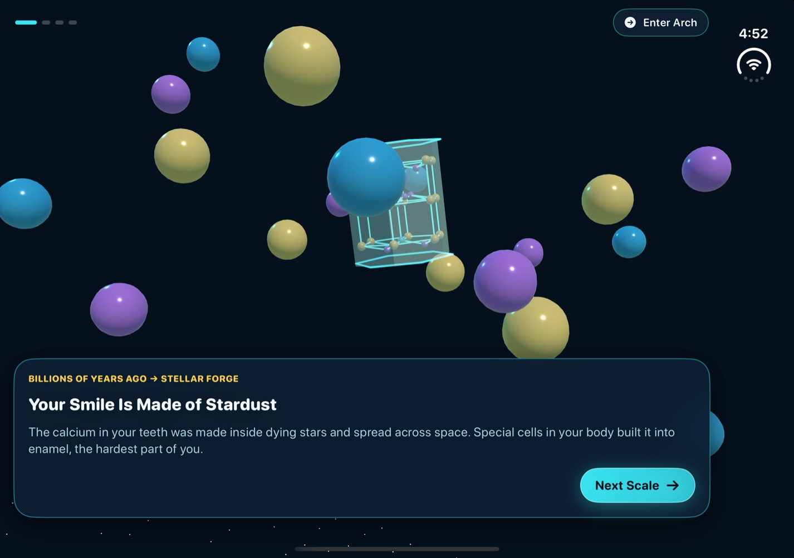 | |
| Home | 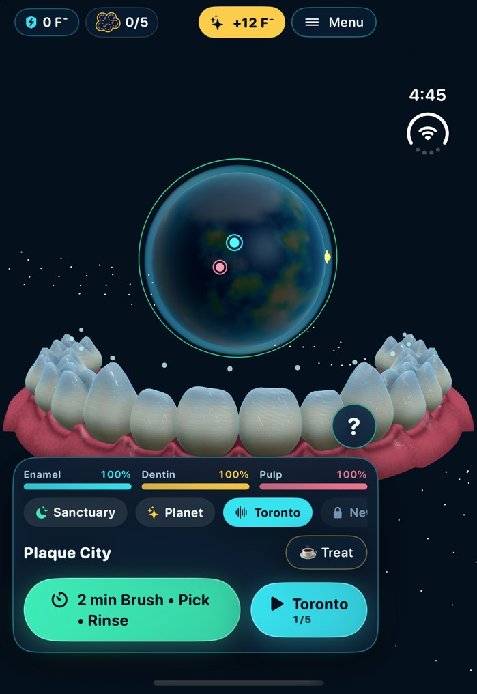 | 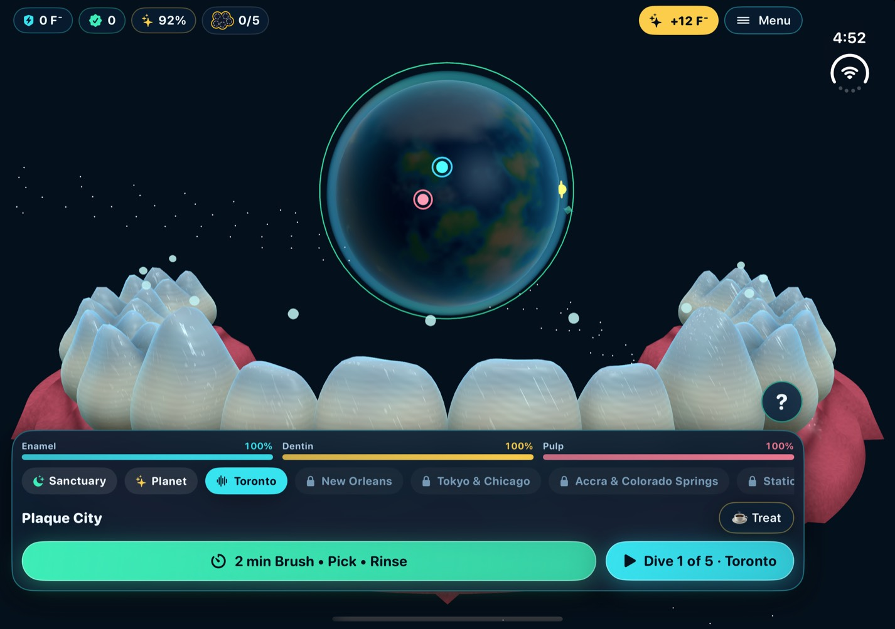 | 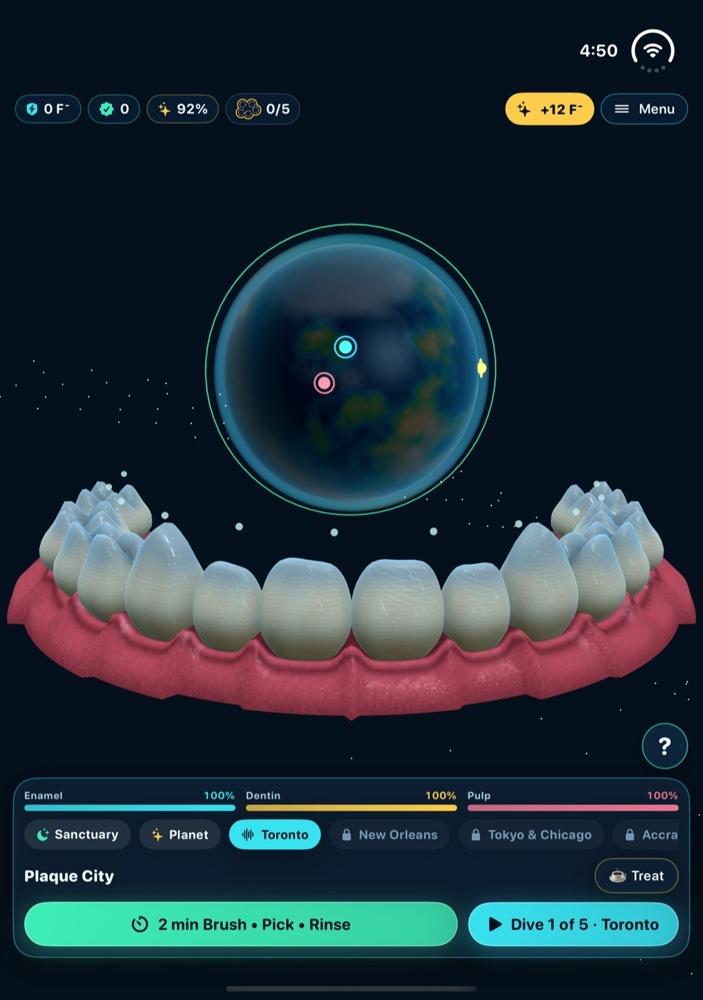 |
| 2-Min Brush | 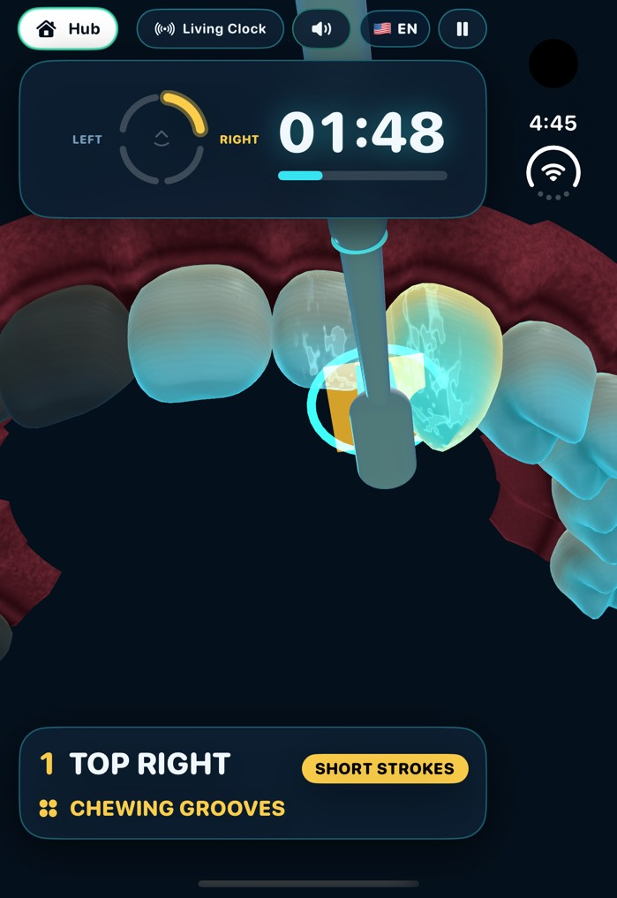 | 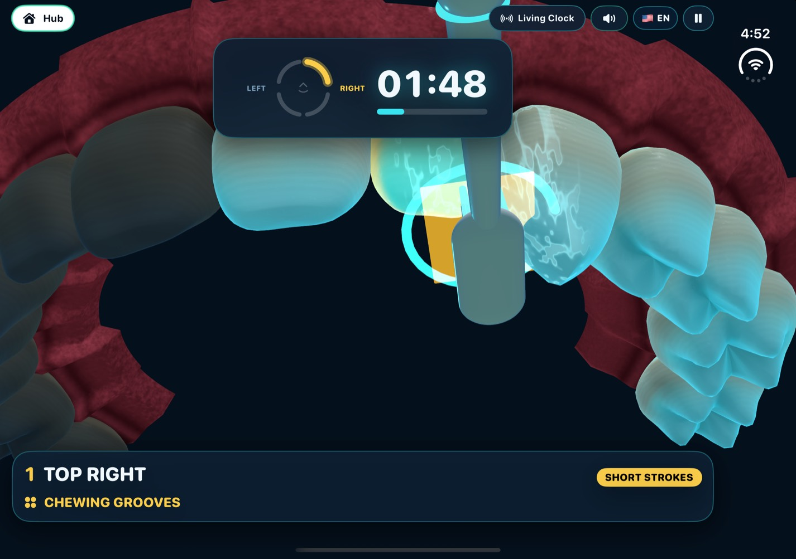 | 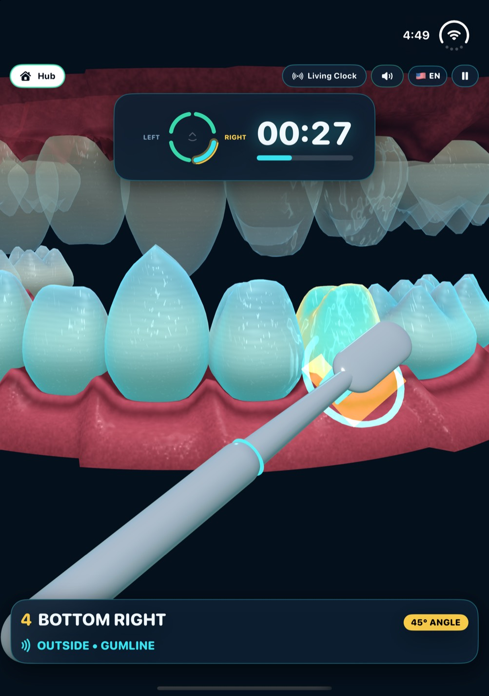 |
| A city stage | 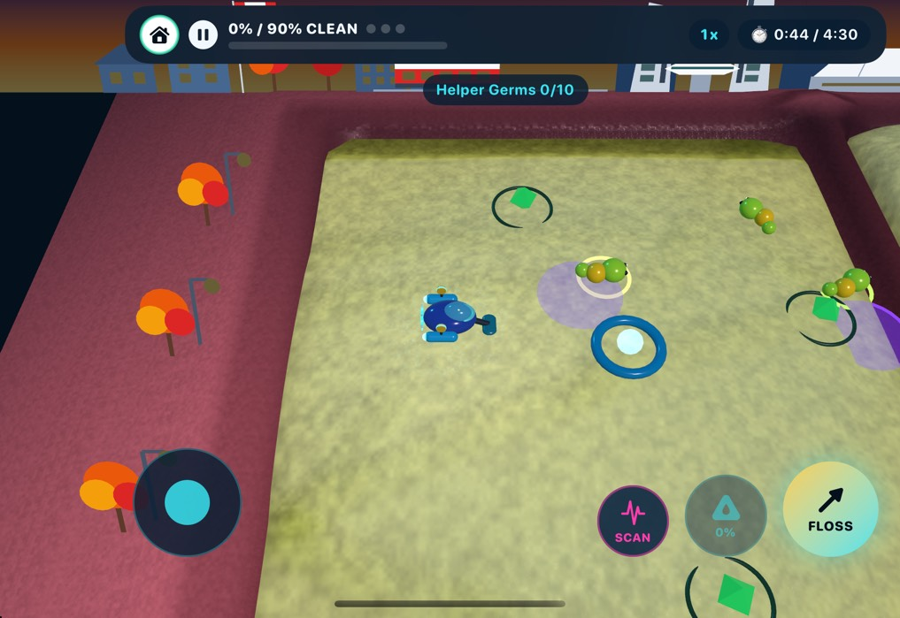 (cover turned sideways) | 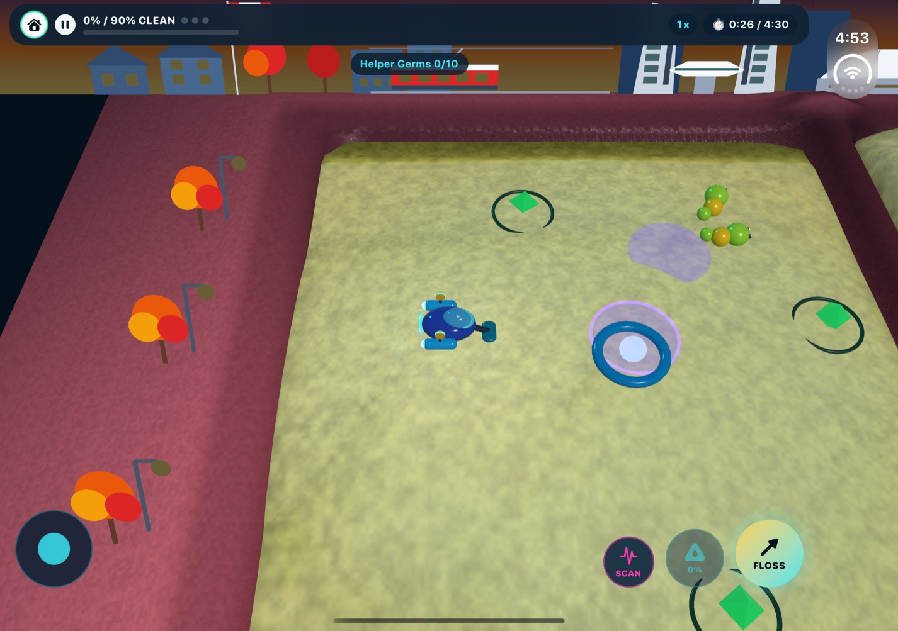 | 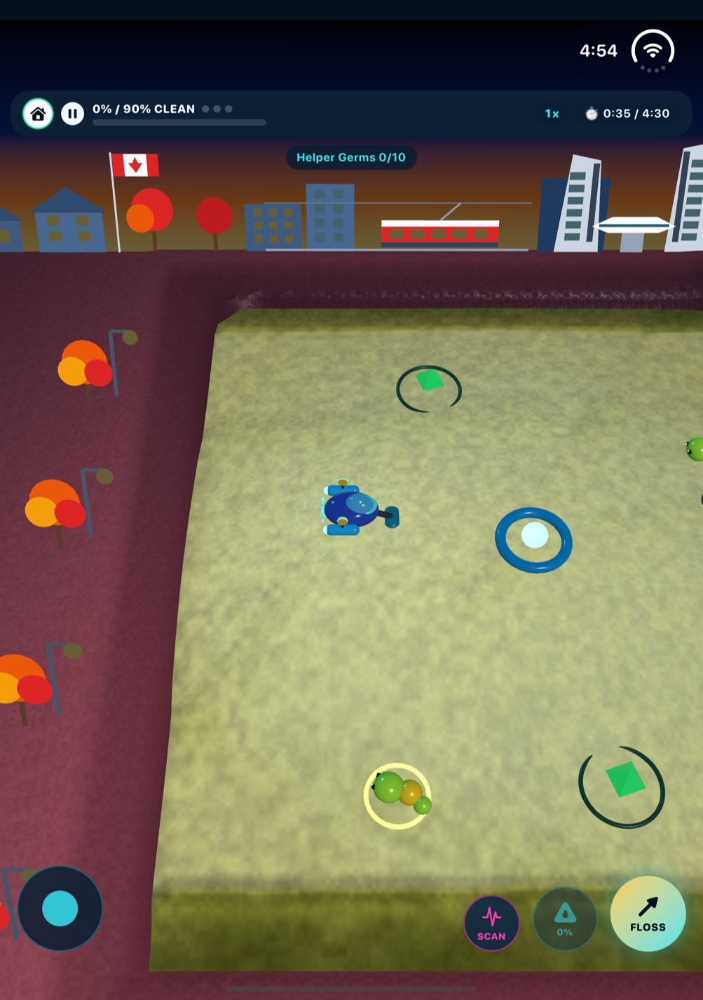 |
| Lock Screen / Home Screen | 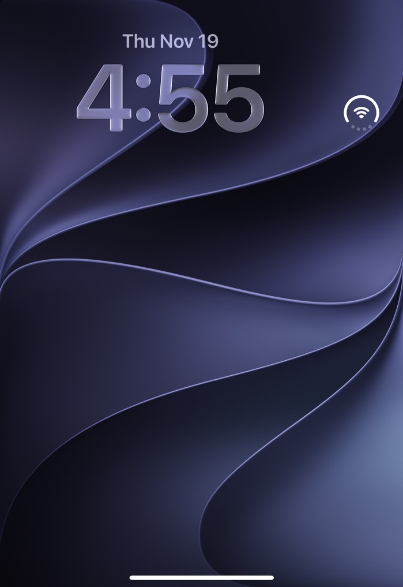 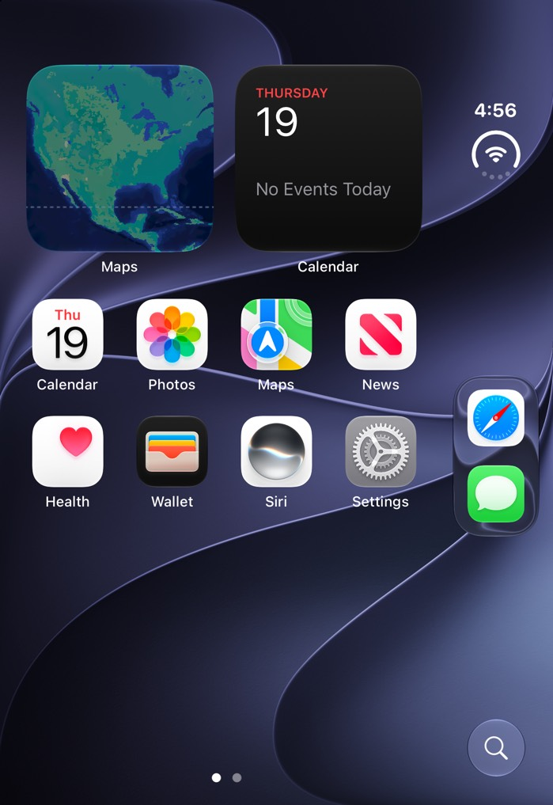 | 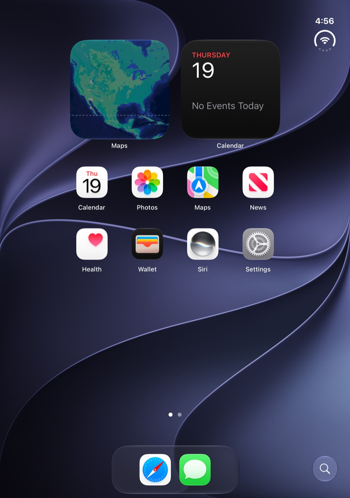 (inner screen turned upright) | |

### What the screenshots show

- **Screen sizes.** Cover: 466 × 678 points upright (678 × 466 sideways). Inner: 951 × 669 open like
  a book, 669 × 951 turned a quarter. The fold should run across the middle of the inner screen's
  long side: down the middle of the book view, across the middle in Tabletop (assumed from the
  postures; the simulator does not draw it). The app must read the real fold at run time.
- **Usable widths are smaller than half the screen.** In the book view the system bar runs down one
  edge (the right, in our captures) and takes about 60-70 points: the page on that side is about
  400 points wide, the size of an iPhone 18 Pro (402), the other about 475. In Tabletop, the status
  bar and the home indicator leave roughly 420 points of height on the upright half and 455 on the
  flat half.
- **It already works.** No crash, no letterboxing, nothing cut off. The app keeps the same process
  through fold, unfold, half-fold, rotation and close. **Folding** keeps a brush and a stage running
  (timer, 3D view, music; a stage was still at 0:44 with no pause card after closing). **Locking**
  pauses both (section 4).
- **Cover.** Upright, the system bar runs down the right edge (time, Wi-Fi) with the camera always in
  its top corner; our safe-area layout stays clear of both. Sideways, the camera sits top-left and
  the Hub button clears it. The screens fit, with the same fallbacks as on a phone (Home's
  "2 min Brush • Pick • Rinse" already wraps to two lines in English there).
- **Inner, open flat.** Layouts simply stretch across the fold:
  - Home: the long **"2 min Brush" button runs across the fold** (a tap target on the crease), and
    the city row and the Earth sit on it. Dive shows its full label, "Dive 1 of 5 · Toronto".
  - 2-Min Brush: the timer card sits centred, **on the fold**; the coaching card spans it. The
    whole-mouth overview (the iPad "duo" layout) does not appear: inside the system bar the screen
    is just under the 900-point width test in `RootContentView`.
  - Stage: the top bar and the play field span the fold; the stick and the buttons do not.
- **Tabletop.** The brush timer is on the upright half; the 3D close-up straddles the fold; the
  coaching card lies on the flat half (glanceable text belongs upright, in the child's eye line).
  In a stage the stick and buttons are on the flat half, which is right for thumbs.
- **Home Screens.** Cover: a 4-column grid with the dock running down the right edge. Inner (turned
  upright): the same 4-column grid, centred, dock at the bottom. Small widgets take 2 × 2 icons on
  both. Held as a wide book, the inner Home Screen shows two pages of icons side by side
  (`book-widget.jpg`, with the Today widget; the cover: `cover-widget.jpg`).

## 2. What to build first

### The idea: two screens, not a big iPad (proposal, 2026-11-19)

The owner's problem statement: a Duo owner should get a game that uses two screens, not the iPad
layout stretched across a crease. Asked separately, agy and Codex both arrived at the same answer:
**one screen shows the tooth you are working on, the other shows where it sits in the whole mouth
or city,** so a child sees one small action change the big picture.

| | Open flat (book) | Tabletop (half-open) |
|---|---|---|
| **City stage** | Left page: the 3D city and the stick, as today. Right page: a live top-down **city map** (the scrubber, each district filling as it gets clean, a gold check when it is sealed, Scan's magenta ring) with Scan, Surge and Floss under the right thumb. | Upright: the 3D city, the timer and the goal, above the child's hands. Flat: the map between the stick (left) and the three buttons (right), like a handheld console. |
| **2-Min Brush** | One page: the 3D close-up, the timer and the cue. Other page: the whole-mouth map showing the same tooth and surface, then the next. | As in item 3 below: the upright half reads at a glance; the flat half is the map and the words, with nothing tappable. |
| **Home** | Left: the companion arch and Earth (rub a crown). Right: the crown card, the city row, Brush, Dive and Treat; a treat chosen on the right lands on the teeth on the left. | Upright: the companion. Flat: the same deck. |

The cover keeps the iPhone layout. Same rules, rewards and saves on every device; nothing about the
hinge is rewarded.

- **The map is a cheap 2D `Canvas`, never a second 3D view.** The SceneKit view also steps the game,
  so a second one risks running it twice and doubles the GPU work. The map reads what the game
  already publishes about 20 times a second (`AppCoordinator.latestSnapshot`: `probePos`,
  `probeFacingRad`, `districtCleanRatios`, `sealedDistricts`, `discloseOrigin`,
  `discloseActiveRemaining`), with the outline cached once from the city's `WorldCartridge`
  (`playableMaskBoxes`, `districts`, `interdentalAlleys`). Nothing new in the 120 Hz render or audio
  paths. Neither edition has a minimap today. District-level progress comes free; exact plaque spots
  would need sampling `OralSurfaceGrid` (later, if at all).
- **Layout:** the manual split at the fold from items 1-2 (one 3D view whose frame changes; `FoldGuide`
  with `.fixed`), not `ArrangementView`, which suits independent content such as sheets.
- **The demo:** Tabletop, Toronto, one district a sweep away from sealed. The child pushes the stick;
  above, the enamel turns gold and that neighbourhood's skyline lights up; below, the district on
  the map gets its gold check while the unfinished ones stay visible.
- **Cost:** about one to two weeks, including tuning: new `FoldGuide.swift` and `StageMapView.swift`;
  changes to `RootContentView`, `ArcadeHudView`, `BrushAlongView`, `BrushOverviewPanel`,
  `CompanionHubView` and the geometry cache in `WatchFaces.swift`. The map could later show on iPad
  too.
- **The reviewers differed on one point:** agy would let a finger on the map steer the scrubber there;
  Codex keeps the map read-only. Suggested: **read-only** (one way to steer is simpler for a
  five-year-old, and nothing new to reset on pause or fold).
- **On hardware:** steady 8.3 ms frames during Scan and scrubbing, heat, touch on the narrower page,
  the camera in the short upright half, a held stick across rotation, and whether a five-year-old
  finds the next district on the map unaided.

Everything Duo-only sits behind `if #available(iOS 27.1, *)` (the app targets iOS 17); on every
other device nothing changes. Release 1 is items 1-4; the rest follow.

1. **The 3D view is never rebuilt (P0, a rule for every item).** `MouthLife3DViewport` stays in one
   structural place in `RootContentView`; layouts around the fold only change its frame, as the iPad
   overview already does (`modes(trailingInset:)`). No `ArrangementView` and no posture `if`/`else`
   around it. Also move `.id(coordinator.coachLanguage)` (today on the container that holds the 3D
   view, so a language change already rebuilds it) to the overlays only. Acceptance: `makeUIView`
   runs once through a full brush with folding, rotating and a language change.
2. **One fold helper (P0, small).** `FoldGuide`, read once per layout from
   `GeometryProxy.reservedRegions(kind: .division, options: .includeInactive,
   layoutDirectionBehavior: .fixed)` inside each screen's safe area. It returns the fold line (or
   none) and which way it runs. The flat fold has zero width, so the helper adds a clear gutter
   (about 24 points each side) where nothing is drawn or tapped. Which half is upright in Tabletop
   comes from the interface (the top half), not from the fold. In Split View, or if the panes come
   out too narrow, it falls back to one pane. New file `native-apple/MouthLifeApp/UI/FoldGuide.swift`;
   no state, no timers, nothing per frame.
3. **2-Min Brush on the inner screen (P0, the core).** `RootContentView.swift`, `BrushAlongView.swift`,
   `BrushOverviewPanel.swift`.
   - Open flat: the iPad layout split at the fold: 3D close-up and timer on one page, whole-mouth map
     on the other. Nothing, not even the timer digits, in the gutter. The fold decides, not the
     900-point test.
   - Tabletop: everything the child reads at a glance on the upright half (3D close-up, timer,
     quadrant); the flat half shows the whole-mouth map and the coaching words, big, and **nothing
     tappable for the whole ritual**: Pause, the overview's Hide, and the floss and rinse cards'
     Done / Skip / Pick / 60 s all sit on the upright half, so sink splashes cannot pause, skip or end
     a stage.
   - Check the 3D camera framing in the short upright half (`updateViewportSize`).
   - Mirror rule: Q1/Q4 screen-right, Q2/Q3 screen-left, on both halves.
   - Profile the overview on hardware before promising 120 Hz: `MouthPacer` (`WatchFaces.swift`,
     drawn by `BrushOverviewPanel`) builds its tooth arrays while drawing; cache them per size.
4. **Home and the first screens on the inner screen (P0).** `CompanionHubView.swift`: the 2-min Brush
   and Dive buttons each on their own side of the fold, in the lower thumb corners; the shield bars
   and city row split the same way. Then check, and fix only what crosses the fold: the Prologue card
   (`CosmicIntroView`), the How to Play card (`TutorialView`), the stage pause card, the score
   (`MissionReportView`), the city finale (`CityFinaleView`: keep the Golden Molar and credits off
   the crease) and the sheets with their nested pages (grown-up gate, privacy policy).
5. **Stage on the inner screen (P1; the first prototype if the owner picks the two-screen idea).**
   `ArcadeHudView.swift`: the top bar's groups split at the fold (house and pause on one side, timer
   on the other). Without the two-screen idea the play field stays full screen; with it, the 3D city
   takes one page and the city map and buttons the other (above).
6. **Mirror labels pinned left-to-right (P1, small, all devices).** `.fixed` only covers the fold
   query. `MirrorArchCompassView` and `MouthwashGyroLevelBar` (`BrushAlongView.swift`) place "LEFT"
   and "RIGHT" in `HStack`s, which a right-to-left layout would swap. Pin those two views with
   `.environment(\.layoutDirection, .leftToRight)`. None of the 8 languages is right-to-left, so
   this is a safeguard, checked with a right-to-left pseudo-language.
7. **Toolbar items get an SF Symbol where it helps (P1, tiny).** The Duo hides icon-less toolbar
   items when bars run vertically. Ours are text-only ("Done" in six sheets, "Not now" in
   `SyncRestoreSheet`); sheets keep horizontal bars, so this is low risk, but `Label(text,
   systemImage:)` costs nothing and also helps VoiceOver.
8. **Save power when the 3D view is covered (P2, all devices).** `MouthLife3DViewport` keeps
   rendering at 120 Hz behind How to Play and full-screen sheets (its `paused` only checks the
   finale). Pause it while fully covered; the big inner screen makes this matter more.

Already fine, nothing to build: continuity through folding, the cover layout, and the 8 languages on
the cover.

## 3. What to cut

- Anything that rewards bending the hinge (a pop-up-book effect on unfold, fold-to-play tricks).
  MouthLife never asks a child to flex the phone.
- `onHingeChange` for the counter-or-hand guess. The guess lives in `GyroSloshSim.step` and works on
  movement, so a still, half-open Duo already reads as "on the counter". Test on hardware first; the
  known soft spots are the `holdBias` roll test and `MotionTiltMonitor`'s use of the interface
  orientation, not the hinge.
- `ArrangementView` for the brush (rule 1). It may still suit sheets later.
- A special "Tent" layout (the phone propped as an A-frame shows the cover, which already works).
- Driving layout from the hinge angle, `UIInterfaceOrientation` or `width / 2`.
- Tri-fold layouts, external displays, Android and web foldables (out of scope).

## 4. Folding and locking mid-brush ("Close to Lock")

- **Folding** (cover ↔ inner): verified fine for a brush and a stage. Nothing to build beyond layouts.
- **Locking** (the side button in our test; iOS 27.3's Close to Lock behaves the same way in
  principle but is unverified, the simulator runs 27.2): the brush pauses and resumes by itself on
  unlock (`AppCoordinator.handleScenePhase`), losing no time or progress; a tick never counts more
  than half a second, so the timer cannot jump after unlock. A stage shows its pause card, as on the
  web. While locked there is no voice and no music, and the Lock Screen shows nothing from MouthLife.
- Keeping the voice going while locked would need background audio, a background timer and probably
  a Live Activity. Both reviewers advise against it for now (section 8).

## 5. Eight languages

- Cover (466 pt) and the narrow book page (about 400 pt) are both at least as wide as the iPhone
  screens where every language fits today, so phone layouts can be reused page by page. The wider
  page (about 475 pt) has room to spare.
- Tabletop halves are short (about 420 pt upright): the upright half must hold the 3D close-up plus
  the timer; the coaching words on the flat half need the long German and French lines checked
  (`BrushCoachCopy`) at large text sizes.
- No new on-screen words are planned for the Duo.
- Checks before shipping: screenshots of each layout in English, German, Japanese and French, cover
  and inner, at the default and an accessibility text size, plus the right-to-left pseudo-language
  run for the mirror view.

## 6. API check (Xcode 27.2 SDK)

| Name in the notes | In the SDK | Notes |
|---|---|---|
| `ArrangementView` | ✅ SwiftUI, iOS 27.1: `ArrangementView(primary:secondary:)`, `.arrangementViewStyle(.automatic / .split / .overlay)` | `.splitArrangementLayoutRatio(...)`, `.splitArrangementLayoutSize(...)`, env `splitArrangementAxis`. UIKit twin `UIArrangementViewController`. Not for the 3D view (section 2, rule 1). |
| `ReservedRegion`, `reservedRegions` | ✅ `ReservedRegion` (`kind` `.occlusion` / `.division`, `frame`, `margins`, `isActive`); `GeometryProxy.reservedRegions(kind:options:layoutDirectionBehavior:)` | Default behaviour is `.mirrors`: pass `.fixed`. Option `.includeInactive` (a flat fold reports zero width). UIKit: `UIView.reservedRegionsOfKind:options:`. |
| `onHingeChange` | ✅ `.onHingeChange(isEnabled:) { old, new in }` | Gives old and new `DeviceHingeContext` (`hinge: DeviceHinge?` with `status` `.closed / .partiallyOpen / .fullyOpen` and `angle`), not a single `context`. UIKit: `UIHinge`, `UIHingeInteraction`. Not needed (section 3). |
| `toolbarVerticalEdge` | ✅ environment value, `HorizontalEdge?` (nil = bars horizontal) | UIKit: `UITraitCollection.verticalBarEdge`. |
| `axisBehavior(_:)`, `ToolbarItemVisibilityPriority` | ✅ `.axisBehavior(.automatic / .horizontalOnly / .verticalPreferred)` (27.1); `.visibilityPriority(.low / .high)` (27.0) | Only if we ever add system toolbars to the main screens. |
| `contentMargins(for:)` | ⚠️ the form in the notes, `contentMargins(for:edges:alignment:)`, is iOS 27.1; the iOS 17 `contentMargins` takes different arguments | Guard by availability and platform (the Mac shares this code). |
| `backgroundExtensionEffect`, `containerRelativeFrame`, `presentationPlacement` | ✅ (iOS 26 / 17 / 27.0) | |
| "HomeView widget APIs" | ❌ none | WidgetKit has no HomeView family or location. `WidgetLocation`: home screen, Lock Screen, StandBy, iPhone widgets on Mac, CarPlay. `HomeExtensions.framework` (new) is for HomeKit accessory makers' settings pages, not for apps like ours. On HomeView, if anywhere, our widgets are ordinary small widgets (see the widget plan on privacy). |
| (not in the notes) | `isDynamicIslandLimitedInWidth` (WidgetKit, iOS 27.0) | Only reports available width, for Live Activities. |

File references in the notes, corrected: there is no session engine to hoist out of
`RootContentView`; `AppCoordinator` (an `@Observable` owned by `MouthLifeApp`) already holds the
brush, the audio and the one 3D scene, which is why folding already keeps everything. The watch faces
(`WatchFaces.swift`) are watchOS drawing code reused only by the iPad overview, and are not needed
for the cover, which runs the full app. The web files named in the notes are out of scope here.

## 7. House rules

- Apple-simple: no new screens or settings; the same screens arranged around the fold.
- Hands-free once 2-Min Brush starts: no new taps; in Tabletop the flat half has no controls at all.
- Minimal voice: no new spoken words.
- Non-punitive, nothing leaves the app: unchanged (no new data, no network).
- 120 Hz with no per-frame allocations: layout runs on change, never per frame; the overview is
  profiled before it is promised.
- Never encourage flexing the hinge: section 3.
- Mirror view never flips: `.fixed` fold queries and pinned mirror labels.

## 8. Questions for the owner (with the reviewers' advice)

1. **"Hold 1.5 s to pause"** on the flat half in Tabletop? Both reviewers: **no**. A five-year-old
   with wet hands should not need a hidden press-and-hold. Instead: no controls on the flat half and
   one single-tap Pause on the upright half, the same as on every other device.
2. **Keep the voice and music going while the phone is locked** (background audio)? Both reviewers:
   **not for now**. The screen already stays awake during a brush (`isIdleTimerDisabled`), so a lock
   is a grown-up's deliberate stop, and today it pauses cleanly. Background audio needs a genuine
   audible purpose for App Review, costs battery, and leaves a brush running that nobody sees.
3. **A Live Activity for a running brush?** Both reviewers: **defer**; see the widget plan.
4. **Release 1 = items 1-4** (3D rule, fold helper, brush, Home and the first screens), then 5-8?
5. **Two screens, not a big iPad** (above): build the city map and the paired pages, starting with
   the stage prototype? If yes, is the map read-only (suggested) or can a finger steer on it? And
   does the map come to iPad and the web edition too (the house rule is that both editions match),
   or stay a Duo presentation?
6. (Asked in chat) **Apple TV**: not planned; MouthLife lives by the bathroom sink, and widgets are
   the cheaper way onto Apple's home screens.

## 9. Acceptance checks (when built)

- Cover, inner flat and Tabletop (both ways round) screenshots of Home, 2-Min Brush, a stage, the
  Prologue, How to Play, the pause card and the score in English, German, Japanese and French:
  nothing tappable or written in the fold gutter.
- A full ritual (2:45 with rinse off, 3:45 with a 60 s rinse) started on the cover, unfolded,
  half-folded, closed: same process, `makeUIView` once, the timer never jumps back, one spoken word
  per change, paid once.
- In Tabletop, splashing the flat half (taps anywhere there) changes nothing.
- Right-to-left pseudo-language: Q1/Q4 still on screen-right, labels unswapped.
- Instruments on hardware (Allocations, frame pacing, energy) through a full ritual in Tabletop:
  no per-frame allocations from the new code.
